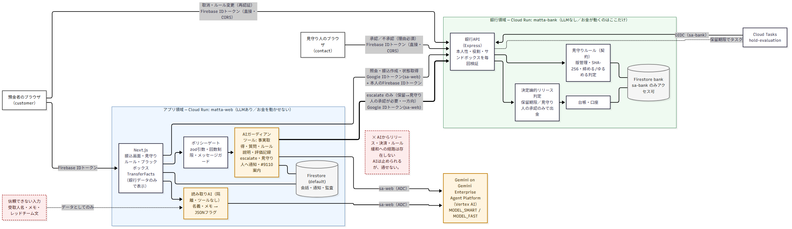

# マッタ — 送金に「待った」をかける見守りエージェント

> **冷静なあなたが決めたルールで、焦っているあなたを守る。**
> ネットバンキングに、窓口の“ひと声”を。

**架空のデモです。実在の銀行・警察とは関係ありません。** 登場する銀行「デモ銀行（架空）」、警察「青嶺県警察（架空）」、人物はすべて架空です。

- デモURL: https://matta-web-760253059957.asia-east1.run.app
- 審査用テストアカウント: 応募フォームの「動作確認の方法」に記載しています（このREADMEには載せていません）。

---

## 一言で

預金者が**落ち着いているときに自分で決めたルール（見守り契約）**に沿って、ネットバンキングの振込を見守るAIエージェントです。日常の支払いはそのまま通り、危ない振込だけを止めて、窓口の行員のように声をかけます。お金を通せるのは、決定論的なルールと、あらかじめ選んだ「見守り人」だけです。**AIは止められるが、通せない。**

## 課題

- 2025年の特殊詐欺は**27,832件・被害額1,423.1億円**（前年比+98.0%）でした。振込型は16,894件・823.0億円で、そのうちインターネットバンキングが使われたのは**6,866件（40.6%）・495.3億円（振込型被害額の60.2%）**です（この内訳は2025年から集計）。
- 警察官等をかたる「ニセ警察詐欺」は11,014件・1,005.0億円で、既遂1件あたりの被害額は922.5万円。認知件数は30代（2,239件）・20代（1,718件）が多く、被害額は70代（274.6億円）が最大です。高齢者だけの問題ではありません。
- 犯行の最初の接触手段は**電話が78.8%**。被害者は電話で指示を受けながら、自分でボタンを押します。
- 窓口なら行員の「ひと声」で気づけることがありますが、アプリにはそれがありません。金融庁は2026年4月16日、ネットバンキングの対策強化、不審な取引の顧客への確認、出金停止・口座凍結の迅速化を金融機関に求めました。
- 一方で現実の対策は、振込限度額の一律引き下げのような「全員を止める」方法になりがちです（例：ある地方銀行は、サポート詐欺やボイスフィッシングの被害を理由に、2026年7月6日から法人IBの都度指定振込の1日限度額を引き下げ）。正当な支払いまで不便になります。
- 警察は実際の詐欺電話の音声を公開し、手口を知ってもらう取り組みを進めています（2026年1月報道）。

出典：
- 警察庁「令和7年における特殊詐欺及びSNS型投資・ロマンス詐欺の認知・検挙状況等について（確定値）」 https://www.npa.go.jp/bureau/criminal/souni/tokusyusagi/hurikomesagi_toukei2025.pdf
- 金融庁（2026年4月16日） https://www.fsa.go.jp/news/r7/sonota/20260416/20260416.html
- 地方銀行の限度額引き下げのお知らせ（2026年7月3日） https://www.saikyobank.co.jp/personal/information/docs/20260703.pdf
- 秋田魁新報（2026年1月28日） https://www.sakigake.jp/news/article/20260128CO0008/
- 警察相談専用電話 #9110 https://www.npa.go.jp/bureau/safetylife/sos47/new-topics/251225/01.html

## 解決策

### ユリシーズ契約（見守り契約）
預金者は落ち着いているときに、自分のルールに署名します（例：登録済みの振込先へは30万円まで即時、新しい振込先への100万円超は見守り人の承認が必要、深夜の新規振込は日常扱いしない、など）。

- **締める変更はすぐ有効**。**ゆるめる変更（見守り人の変更を含む）は72時間の冷却期間後**、または既存の見守り人の同意があったときだけ有効です。見守り人には必ず通知されます。「設定で保護をオフにして」は詐欺の定番の指示だからです。
- 契約はバージョン管理され、SHA-256ハッシュ付きで銀行側に保存されます。

### 三段階の判定（決定論）
1. **日常**：契約の範囲内ならそのまま即時に振り込まれます。
2. **保留**：範囲外は24時間保留（銀行が確認済みの振込先は1時間）。
3. **見守り人の承認が必要**：新しい振込先への高額振込、受取人名やメモに危険な語がある場合、ルールをゆるめる申請中など。

### AIガーディアン（声かけ）
保留中の振込に対して、Geminiのエージェントが窓口の行員のように一つずつ質問します（ご用途、振込先を知った経緯、通話中かどうか、口止めされていないか）。会話から詐欺のパターンを読み取り、**コードが**エスカレーション（保留→見守り人の承認が必要）を決めます。AIが緩める方向に動ける道は存在しません。

### 見守り人
あらかじめ選んだ家族などが、アプリ内で承認／不承認を決めます。見えるのは判断に必要な事実と理由だけで、残高や会話の全文は見えません。

## 審査員ガイド

アプリ内の `/guide`（審査員ガイド）と同じ内容です。

1. `customer-N` でログインし、残高と「見守りルール」を確認します。
2. 別のウィンドウ（シークレットウィンドウ推奨）で `contact-N` にログインします。`customer-N` 側の `/demo` でシナリオ「ニセ警察」を開始します（自動シミュレーションをオンにすると一人でも最後まで進みます）。
3. 振込の詳細から「ブラックボックス」を開き、アプリと銀行の両方の記録を確認します。

同時に複数の方が試す場合は、別々のペア（1〜3）をお使いください。各サンドボックスは `/demo` からリセットできます。

## デモの流れ

1. **契約**：花子さんが落ち着いているときにルールに署名し、姉の美咲さんが見守り人になります。
2. **ニセ警察（S1）**：「青嶺県警察（架空）」を名乗る電話に指示され、新しい振込先へ300万円。→ ルールにより「見守り人の承認が必要」。AIガーディアンが質問し、説明と状況の食い違いを見つけ、理由を添えて美咲さんに知らせ、#9110を案内します。お金は口座から出ていません。
3. **反撃**：「設定で保護をオフに」と言われて変更を試みても、ゆるめる変更は72時間保留され、美咲さんに通知されます。美咲さんが理由を読んで「承認しない」→ 振込は取消。
4. **架空料金請求（S2）**：29万円は「保留」帯ですが、AIが急かしや法的措置の脅しを読み取ってエスカレーション。24時間待っても自動では振り込まれません。
5. **日常は止めない**：家賃は即時に振り込まれ、中古車の代金は美咲さんの承認ですぐに振り込まれます。
6. **ブラックボックス**：両サービスの全ステップと「AIによる送金の実行：0件」を確認できます。

## アーキテクチャ



- **アプリ領域（Cloud Run: `matta-web`）**：Next.js。AIガーディアンと読み取りAI（Gemini）を持つが、**お金を動かす経路を持たない**。銀行への書き込みは `escalate`（保留→見守り人の承認が必要、一方向）だけ。
- **銀行領域（Cloud Run: `matta-bank`）**：Express。台帳、見守り契約、決定論的なリリース判定、Cloud Tasks による保留期限の評価。**LLMなし。お金が動くのはここだけ。**
- **packages/core**：zodスキーマ、契約の締める／ゆるめる判定、振込判定、リリース条件、キーワード事前チェック、メッセージガード（純粋なTypeScript、単体テスト付き）。
- **データ**：Firestore。アプリ用 `(default)` と銀行用 `bank` を分け、IAM条件で `sa-web` は `(default)` だけ、`sa-bank` は `bank` だけにアクセスできます。
- **リージョン**：Cloud Run は asia-east1、Firestore・Cloud Tasks・Artifact Registry は asia-northeast1（asia-northeast1 で Cloud Run のプロジェクト初期化が通らなかったため。`docs/DECISIONS.md` 参照）。

## ガバナンス設計

| 原則 | 実装 |
|---|---|
| お金は銀行でしか動かない | アプリ側にリリース・決済の経路やAPIがないことをテストで確認 |
| 単調な安全性 | AIにできるのは質問・説明・保留継続・エスカレーション・通知だけ。逆方向のエンドポイントは存在しない |
| 契約は本人のもの | 署名・変更に直近の再認証（5分以内）が必要。ゆるめる変更は冷却期間か見守り人の同意 |
| 見守り人は最小権限 | 自分のサンドボックスの承認／不承認だけ。残高・会話全文・送金開始は不可 |
| 信頼できない入力はデータのまま | 受取人名・メモはツールを持たない読み取りAIがJSONに変換するだけ。顧客のチャットにも権限はない |
| 信頼できる表示 | 金額・振込先・状態・ルール文は銀行データから決定論的に表示。LLMの文章では表示しない |
| 本人性の検証 | 毎回 Firebase IDトークン（役割・サンドボックス）、サービス間は Google IDトークン（`sa-web` 許可リスト）、Cloud Tasks は OIDC（`sa-bank`） |
| すべて監査 | 両サービスで AuditEvent（actor, ruleId, mandateHash, policyHash, model, tokens, 推定コスト, latency） |
| フェイルセーフ | LLMの失敗・タイムアウト・不正出力 → 見守り人の承認が必要。誤作動率が高いとガーディアンを一時停止（保留はそのまま） |
| 押しつけない・責めない | です・ます、「詐欺です」と断定しない、暗証番号等を聞かない、抜け道を示さない、#9110だけを案内 |
| デモの誠実さ | 架空の銀行・警察・人物、常設バナー、レッドチームは既知の手口を言い換えた台本のみ（公開資料には載せない） |

## 評価結果

詳細は [`docs/EVAL.md`](docs/EVAL.md) を参照してください。

| 指標 | 結果 |
|---|---|
| ルールで見守り人の承認が必要になった振込が承認なしに出金された件数 | 〔EVAL待ち〕 |
| ゆるめる変更の遅延・見守り人への通知 | 〔EVAL待ち〕 |
| 認可テスト（なりすまし等）の拒否率 | 〔EVAL待ち〕 |
| LLM障害注入時のリリース件数 | 〔EVAL待ち〕 |
| 保留帯の詐欺に対するエスカレーション再現率（held-out セットB） | 〔EVAL待ち〕 |
| 正当な振込の誤エスカレーション率 | 〔EVAL待ち〕 |
| 1件あたり推定コスト／ガーディアン応答時間 p50・p95 | 〔EVAL待ち〕 |

## 制限事項

- 銀行は架空の「デモ銀行（架空）」で、実在の銀行APIには接続していません。実運用では銀行のAPIに置き換える前提です。
- 詐欺のシナリオは台本です。音声や実際の通話の信号は扱いません。
- 評価は台本シナリオによるもので、実際の被害者の行動を代表するものではありません。
- 見守り人の応答時間は仮定値で評価しています（EVAL.md参照）。
- AIガーディアンの1ステップは数秒〜20秒程度かかります。タイムアウト時は安全側（見守り人の承認が必要）に倒れます。
- 通知はアプリ内のみです（SMS・メールは送りません）。

## 今後の展開

- **暗号資産・証券**：暗号資産の送付や証券口座からの出金にも同じ「契約＋見守り」を適用。
- **銀行アプリへの組み込み**：銀行の勘定系・API（各行のサンドボックスAPIなど）に接続し、窓口の「ひと声」をアプリに。
- 通話中かどうかなど、端末側のシグナルの活用（本人の同意のもとで）。

## 使用技術

- **Google Cloud**：Cloud Run（2サービス）、Gemini on Gemini Enterprise Agent Platform（旧 Vertex AI。`@google/genai`、ADC）、Firestore（複数データベース）、Cloud Tasks（OIDC）、Secret Manager、Cloud Build、Artifact Registry、Cloud Logging
- **Firebase**：Firebase Authentication（メール＋パスワード）
- **モデル**：`MODEL_FAST=gemini-3.5-flash-lite`（読み取りAI）、`MODEL_SMART=gemini-3.8-flash`（ガーディアン）。モデルIDは環境変数からのみ読み込み、`pnpm check:models` で利用可否を確認
- **言語・ライブラリ**：TypeScript（strict）、Next.js（App Router）、Tailwind CSS、Express、zod、vitest、pnpm workspace

## セットアップ

```bash
pnpm install
cp .env.example .env.local   # 各セクションをルート / apps/web / apps/demo-bank の .env.local に
gcloud auth application-default login
pnpm check:models            # モデルが使えるか確認（Gemini 2.5 は不可）
pnpm seed                    # テストユーザーとサンドボックスを作成
pnpm dev                     # web :3000 / bank :8081
pnpm typecheck && pnpm test
pnpm scenarios:validate
```

- ローカルでは `TASKS_MODE=inline`、`S2S_DEV_INSECURE=true`（本番では無効）、`DEMO_MODE=true` を使います。
- Firebase：プロジェクトにFirebaseを追加し、メール／パスワード認証を有効化し、Webアプリを登録します（コンソール、または `docs/DECISIONS.md` にある REST API の手順）。
- クラウド：`bash infra/setup.sh`（API、サービスアカウント、IAM、Firestore、Cloud Tasks、Secret Manager）→ `pnpm deploy:all` → `pnpm smoke`。詳細は `infra/README.md`。
